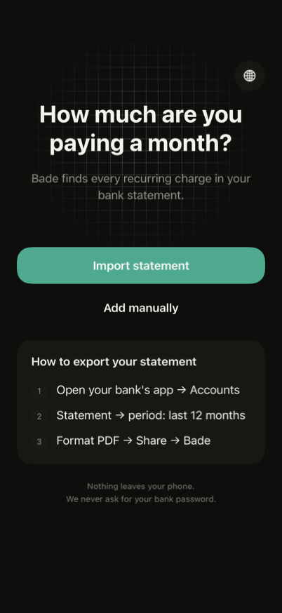
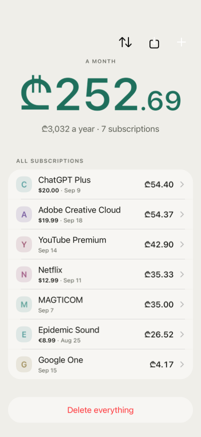
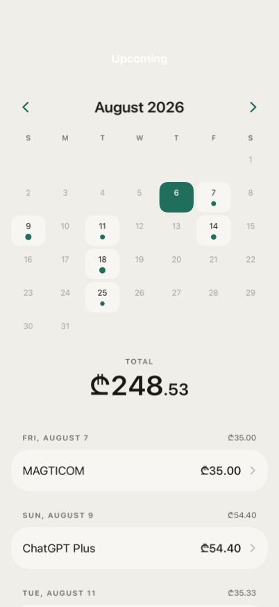
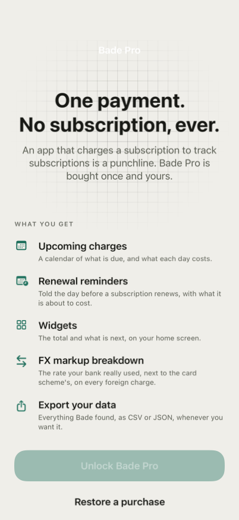
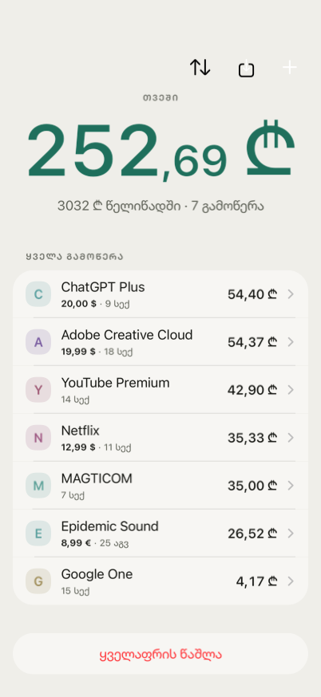
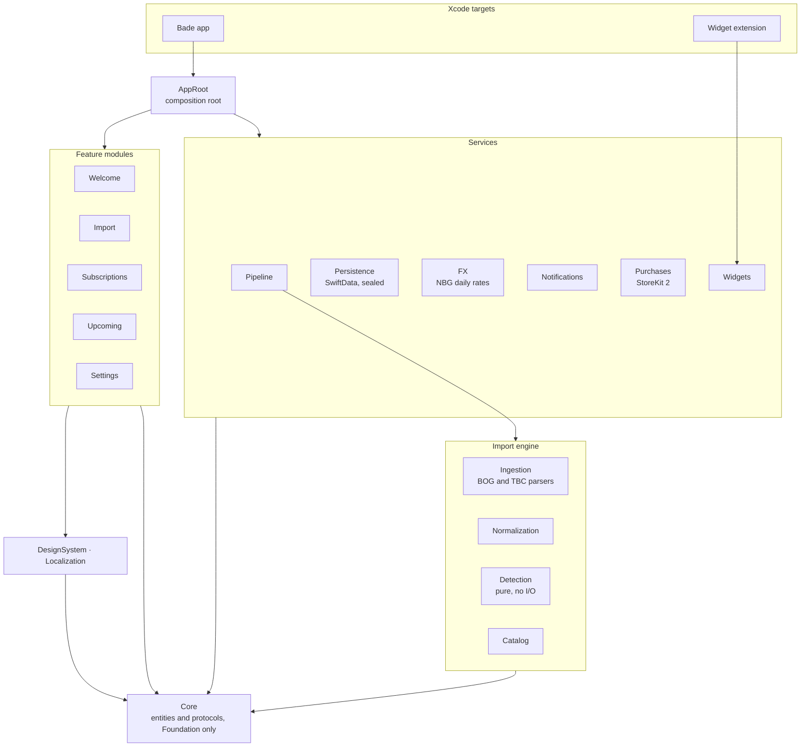
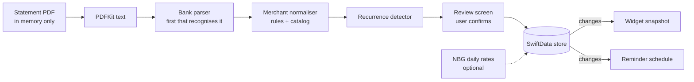

<div align="center">


# Bade

**How much are you paying a month?**

[App Store](https://apps.apple.com/ge/app/bade/id6804193538) · [badeapp.com](https://badeapp.com)

</div>

---

Bade is a subscription tracker for iPhone, built for the Georgian market. Export a PDF
statement from your banking app and share it into Bade. It reads every transaction on
your phone and works out which charges repeat (weekly, monthly, quarterly, semiannual or
annual), how sure it is about each one, and what you really pay per month in the currency
you choose. It catches price changes. When your bank converted a foreign charge, it shows
what the bank's exchange rate cost you against a reference rate. It puts upcoming charges
on a calendar, reminds you before they land, and shows your monthly total in a home-screen
widget. Bade never asks for bank credentials, has no accounts and no backend, and never
writes the statement to disk.

## Screenshots

| Welcome | Subscriptions | Upcoming | Pro | Georgian |
|:---:|:---:|:---:|:---:|:---:|
|  |  |  |  |  |

<sub>These are the snapshot tests' own reference images: the real app rendered with sample data.</sub>

## Architecture

Nearly all code lives in one Swift package, `BadeKit`, split into targets with enforced
boundaries:

- `Core` holds entities and protocols and depends on nothing but Foundation.
- Feature modules never import each other.
- SwiftData is sealed inside `Persistence`.
- Only `AppRoot`, the composition root, sees every module.

The Xcode project is two thin shells: the app's `@main` shows `BadeRootView()`, and the
widget extension shows `Widgets.BadeWidget()`.



**One import, end to end.** Features see the pipeline only through
`Core.StatementImporting`, and storage only through `Core.SubscriptionRepository`.



**Every screen is MVI.** A `State` struct holds `private(set)` fields, an `Intent` enum
names what can happen, and a pure `State.apply(intent) -> Effect?` decides what changes.
An `@MainActor @Observable` view model runs the effect (load, save, delete) and feeds
the result back as another intent. A screen reports how it was left through a single
`Outcome` enum, not a set of closures.

### Decisions worth knowing about

- **Money is always `Decimal`.** Floating point never touches an amount, a rate or a
  total.
- **Arithmetic is deterministic Swift.** Merchant cleanup is a chain of rules plus a
  bundled catalog. Cadence, totals, FX and detection are plain code you can read and
  test.
- **Cadence by phase fitting.** The detector projects each rhythm and counts how many
  charges land on it, rather than chaining day-to-day gaps. Billing on the 31st or one
  late charge doesn't break a subscription. Confidence comes from the number of repeats
  and from matches against known services' published prices.
- **FX is reported only when it happened.** A foreign charge paid from a balance already
  in that currency was never converted, and Bade says so. When the bank did convert, its
  rate is compared with the card-scheme rate printed on the statement or with the
  National Bank of Georgia's published rate, and the screen names which one it used.
- **Storage that can't brick the app.** The SwiftData schema is versioned with a
  migration plan. A store that can't be opened is moved aside, not deleted, and the user
  is told once.
- **One place for each system API.** StoreKit lives only in `Purchases`,
  UserNotifications in `Notifications`, and SwiftData in `Persistence`. Everything else
  depends on protocols in `Core`.

## Privacy

- **Statement files are never written to disk.** They're parsed in memory and discarded.
- **No accounts, no backend, no analytics, no crash reporting.** There is no server to
  send anything to.
- **No bank credentials, ever.** Bade reads a file you already exported.
- **One optional network call.** If a statement doesn't print a rate to compare against,
  Bade can ask the National Bank of Georgia for that day's published rates. The request
  asks for a whole day, never for a particular currency, and carries no account data.
  It's a toggle in Settings, and the app works fully with it off.

## Bade Pro

An app that charges a subscription to track subscriptions is a punchline. Bade Pro is
**one payment, no subscription, ever**: a non-consumable purchase tied to your Apple
Account. It unlocks the upcoming-charges calendar, renewal reminders, the exchange-rate
breakdown, the home-screen widget and export to CSV or JSON.

## Tech stack

- **Language:** Swift 6 with strict concurrency (Swift tools 6.2).
- **UI:** SwiftUI and Observation, with an MVI feature architecture and TipKit hints.
- **Persistence:** SwiftData behind a `@ModelActor`.
- **Statements:** PDFKit for text extraction, with a parser per statement format:
  Bank of Georgia (Georgian and English exports) and TBC.
- **Networking:** a single `URLSession` call for National Bank of Georgia rates, run as a
  task group with a timeout.
- **Platform:**
  - StoreKit 2: Pro as a non-consumable.
  - WidgetKit, fed through an App Group.
  - UserNotifications: reminders planned by pure date arithmetic, within iOS's
    64-pending-notification limit.
- **Localization:** English and Georgian in one String Catalog, read through typed keys,
  so a typo is a compile error.
- **Accessibility:**
  - Dynamic Type up to accessibility sizes;
  - light and dark mode;
  - Reduce Motion and Increase Contrast;
  - money always shows its currency symbol (₾, $, €), placed where the reader's locale
    expects it.
- **Testing:**
  - Swift Testing throughout.
  - Golden-file tests run scrubbed real statements from both banks through the real
    parsers and detector.
  - Pixel-compared snapshot tests run in light, dark, Georgian, accessibility text size
    and increased contrast.
- **Dependencies:** none outside Apple's SDKs.

Real statements never enter the repository. The golden fixtures are scrubbed derivatives:
real dates, amounts, currencies and MCCs, with merchant names replaced unless the bundled
catalog already knows them publicly, and branch addresses stripped.

## How to build

Requires Xcode 26 and iOS 26. Open `Bade.xcodeproj` and run the **Bade** scheme.

All real code is in `BadeKit`. The package also declares macOS, so the full unit and
golden suite runs on the host without a simulator (a Mac on macOS 26):

```bash
cd BadeKit && swift test
```

Snapshot tests need an iOS simulator:

```bash
cd BadeKit && xcodebuild -scheme BadeKit-Package -destination 'platform=iOS Simulator,name=iPhone 17 Pro' -only-testing:SnapshotTests test
```

## What's next

- **More statement formats.** Only Bank of Georgia and TBC exports are recognised
  today.
- **Read every BOG exchange record.**
  - Strip page headers and balance strips that land mid-record in English exports.
  - Read the "Automatic conversion, rate:" rows, which carry a rate with no
    counter-amount.
- **Spending insights:** category analytics, spending trends and price-increase alerts.
  These are planned, not shipped, and the Pro page doesn't list them.
- **Themes.**

---

## License

Source-available. Copyright © 2026 Daviti Khvedelidze. All rights reserved.

You're welcome to read this code, learn from it, and reference it. It is **not** licensed for reuse, redistribution, or derivative works. Bade is a commercial product.

Bade is an independent app and is not affiliated with, endorsed by, or sponsored by any bank or financial institution.
